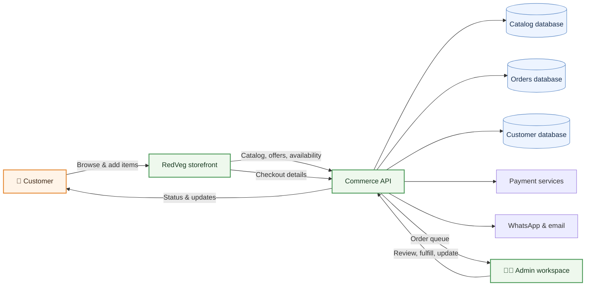
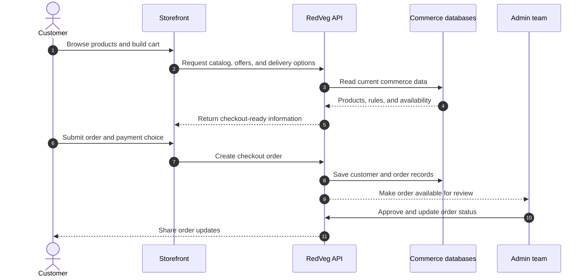
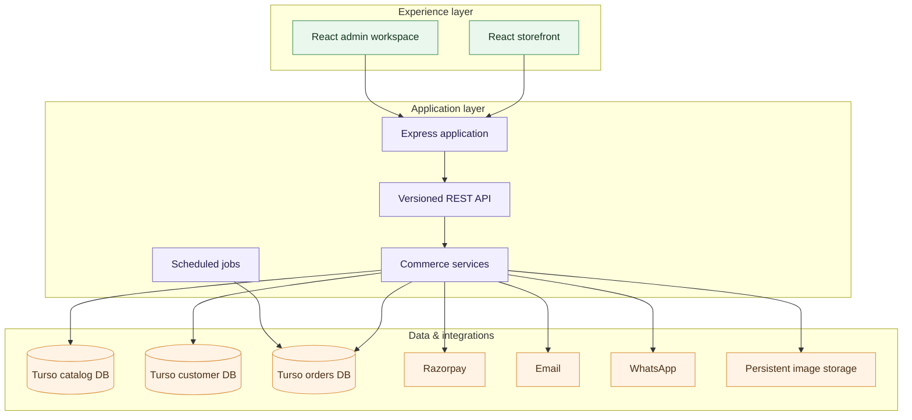

<div align="center">

# 🥬 RedVeg

### Fresh food commerce, from product discovery to doorstep delivery.

**A full-stack commerce and operations platform for fresh fish, poultry, and meat.**


[](https://nodejs.org/)
[](https://react.dev/)
[](https://expressjs.com/)
[](https://www.typescriptlang.org/)
[](LICENSE)

<br />

**Storefront** · **Admin workspace** · **Commerce API** · **Delivery operations**

</div>

---

## ✨ What is RedVeg?

RedVeg brings the customer shopping journey and the day-to-day work of running a fresh-food business into one connected system. Customers can browse products and offers, build a cart, choose delivery details, and place orders. Staff can manage the catalog, orders, customers, promotions, delivery areas, and store settings through a protected admin workspace.

The platform is designed around the practical details of perishable commerce: availability, delivery coverage and slots, order review, payment confirmation, and clear customer communication.

## 🧭 How it works



### A typical order journey



## 🧰 Product capabilities

| 🛍️ Customer experience | 🧑‍🍳 Store operations |
| --- | --- |
| Product catalog, categories, variants, and combos | Catalog, category, and image management |
| Search, product details, cart, and wishlist | Order review, manual orders, and status tracking |
| Offers, campaigns, and coupons | Staff accounts and permission-aware admin pages |
| Customer accounts and order history | Customer management and active-cart visibility |
| Delivery area and slot selection | Delivery areas, fees, and delivery slots |
| Razorpay checkout and WhatsApp-assisted flows | Payment review, business policies, and store settings |
| Responsive storefront and customer policies | SEO, banners, campaigns, and operational reporting |

> Feature availability depends on the environment configuration and enabled integrations.

## 🏗️ Architecture at a glance



## 🗂️ Project map

```text
RedVeg/
├── server/                         Express backend
│   ├── api/v1/                     Versioned routes and controllers
│   ├── config/                     Environment and database setup
│   ├── middleware/                 Authentication, uploads, and errors
│   ├── services/                   Payments, delivery, orders, media, and more
│   ├── jobs/                       Scheduled maintenance jobs
│   └── server.js                   Backend entry point
├── frontend/redveg-commerce-ui/
│   ├── client/src/pages/           Storefront and admin screens
│   ├── client/src/components/      Shared UI and page components
│   ├── client/src/contexts/        Cart, auth, location, and campaign state
│   └── client/src/lib/             API clients and browser utilities
├── database/
│   ├── catalog-db/                 Catalog schema and seed data
│   ├── customer-db/                Customer schema and seed data
│   └── orders-db/                  Order schema and seed data
├── scripts/                        Data sync and maintenance utilities
├── test/                           Backend and integration tests
├── docs/                           Payment and operational notes
├── package.json                    Backend scripts and dependencies
└── pnpm-workspace.yaml             Workspace configuration
```

## ⚙️ Technology

| Layer | Tools |
| --- | --- |
| Backend | Node.js 22, Express 4 |
| Storefront and admin | React 19, TypeScript, Vite, Wouter |
| Data | Turso / libSQL, split by catalog, customer, and order concerns |
| Payments and messaging | Razorpay, WhatsApp-assisted checkout, email integration |
| Media | Image processing and persistent server-side image storage |
| Security | JWT and customer authentication, permission-aware admin routes, rate limiting |

## 🚀 Run locally

### Requirements

- Node.js 22
- npm for the backend, and pnpm for the frontend workspace
- Turso credentials for the database-backed flows you want to run

### 1. Configure the backend

```bash
npm install
Copy-Item .env.example .env
```

Fill in the required values in `.env`. Do not commit real credentials. At minimum, configure the database URLs and tokens used by your environment, and a strong `JWT_SECRET`. The app also supports settings such as `PORT`, `CORS_ORIGIN`, `UPLOADS_DIR`, `APP_PUBLIC_URL`, and payment or email provider credentials. Check [`.env.example`](.env.example) for the current variable names.

### 2. Start the API

```bash
npm start
```

The backend listens on `PORT` (default `3000`). Its health endpoint is:

```text
GET http://localhost:3000/api/v1/health/ping
```

### 3. Start the storefront

```bash
cd frontend/redveg-commerce-ui
pnpm install
pnpm dev
```

Vite serves the frontend at `http://localhost:5177`. Configure its API base URL and any authentication or map integrations in the appropriate local frontend environment file.

## 🧪 Useful commands

| From | Command | Purpose |
| --- | --- | --- |
| Repository root | `npm start` | Start the Express backend |
| Repository root | `npm run dev` | Start backend with nodemon |
| Repository root | `npm test` | Run Node.js test suite |
| Frontend directory | `pnpm dev` | Start the Vite development server |
| Frontend directory | `pnpm build` | Build frontend assets and its server bundle |
| Frontend directory | `pnpm check` | Type-check the frontend |

## 🔐 Deployment notes

The backend is configured for Node.js 22 hosting. Production deployments need the correct database credentials, JWT secret, public URL, allowed storefront origins, and persistent image storage. Keep `.env` files and production secrets out of source control. After deployment, check the runtime logs and call `/api/v1/health/ping` to confirm the API is available.

The frontend is a separate Vite application. Build and deploy it with the frontend's own environment settings, pointing its API client at the deployed backend.

## 👤 Built by

**RedVeg is built by [Anurag Naskar](https://github.com/anuragdoesntex1sts), Founder of [AIZEN TECHNOLOGIES](https://github.com/anuragdoesntex1sts).**

## 📄 License

This project is licensed under the MIT License. See [`LICENSE`](LICENSE) for details.

<div align="center">

Made with care for better fresh-food commerce. 🥬

</div>
